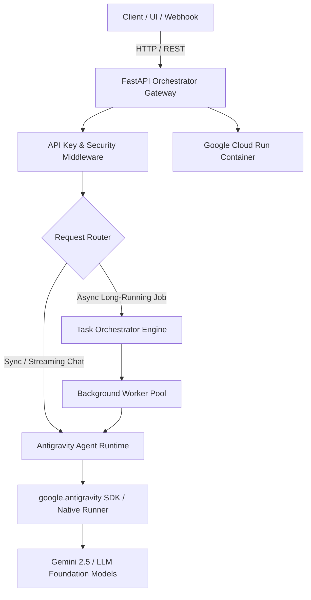

# Cloud Antigravity (AGY) Orchestrator 🚀

[](https://cloud.google.com/build)
[](https://cloud.google.com/run)
[](https://fastapi.tiangolo.com)
[](https://www.python.org/)

Scalable, asynchronous cloud orchestrator and autonomous agent service designed for **Google Antigravity (AGY)** agent workflows, task pipelines, and background execution.

---

## 🏛 Architecture Overview



---

## 🌟 Key Features

- **Autonomous Agent Service**: Full integration with the Antigravity Python SDK for leasing agents, handling reasoning streams, and tool execution.
- **Asynchronous Task Orchestration**: Background queue for dispatching, monitoring, and inspecting long-running agent workflows.
- **Production Containerization**: Multi-stage `Dockerfile` tuned for lightweight container deployment on Google Cloud Run.
- **Automated CI/CD**: Cloud Build pipeline (`cloudbuild.yaml`) and deployment script (`deploy/cloud-run.sh`).
- **Configurable Security**: Built-in API Key authentication and CORS support.

---

## 📂 Project Structure

```
cloud-agy-orchestrator/
├── src/
│   ├── __init__.py
│   ├── config.py          # Pydantic environment configuration
│   ├── main.py            # FastAPI entrypoint & route definitions
│   ├── models.py          # Request/response schemas & data models
│   ├── agent.py           # Antigravity agent lifecycle & SDK wrapper
│   └── orchestrator.py    # Background task scheduler & tracker
├── tests/
│   ├── __init__.py
│   └── test_api.py        # Test suite
├── deploy/
│   └── cloud-run.sh       # One-click Google Cloud Run deployment script
├── Dockerfile             # Multi-stage production container
├── docker-compose.yml     # Local orchestration environment
├── cloudbuild.yaml        # Google Cloud Build CI/CD config
├── pyproject.toml         # Packaging & metadata
├── requirements.txt       # Dependencies
└── .env.example           # Configuration template
```

---

## 🚀 Quickstart

### 1. Local Development

```bash
# Clone the repository
git clone https://github.com/aminniktash2010/cloud-agy-orchestrator.git
cd cloud-agy-orchestrator

# Create & activate virtual environment
python3 -m venv venv
source venv/bin/activate

# Install dependencies
pip install -r requirements.txt

# Run the local server
uvicorn src.main:app --host 0.0.0.0 --port 8080 --reload
```

Once running, interactive API docs are available at [http://localhost:8080/docs](http://localhost:8080/docs).

### 2. Docker & Docker Compose

```bash
# Build and run container locally
docker compose up --build
```

---

## 📡 REST API Reference

| Method | Endpoint | Description | Auth Required |
|---|---|---|---|
| `GET` | `/health` | Service health status and readiness check | No |
| `GET` | `/` | Service overview and documentation links | No |
| `POST` | `/v1/agents/chat` | Send prompt to Antigravity Agent and receive structured response | Optional (`X-API-Key`) |
| `POST` | `/v1/tasks/run` | Dispatch long-running agent task to background queue | Optional (`X-API-Key`) |
| `GET` | `/v1/tasks/{task_id}` | Check status and results of a scheduled task | Optional (`X-API-Key`) |
| `GET` | `/v1/tasks` | List recent orchestrator tasks | Optional (`X-API-Key`) |

### Example: Dispatching a Task

```bash
curl -X POST http://localhost:8080/v1/tasks/run \
  -H "Content-Type: application/json" \
  -d '{
    "title": "Analyze Repository Architecture",
    "goal": "Inspect workspace dependencies and suggest optimizations.",
    "timeout_seconds": 300
  }'
```

---

## ☁️ Cloud Run Deployment

Deploy directly using Google Cloud SDK:

```bash
export GCP_PROJECT_ID="your-gcp-project-id"
export GCP_REGION="us-central1"

./deploy/cloud-run.sh
```

Or trigger an automated build via Cloud Build:

```bash
gcloud builds submit --config=cloudbuild.yaml .
```

---

## ⚙️ Environment Configuration

| Variable | Default | Description |
|---|---|---|
| `PORT` | `8080` | Port for the HTTP server |
| `ENVIRONMENT` | `production` | Deployment environment (`development`, `staging`, `production`) |
| `LOG_LEVEL` | `info` | Logging verbosity (`debug`, `info`, `warning`, `error`) |
| `ORCHESTRATOR_API_KEY` | `""` | Optional shared secret for `X-API-Key` authentication |
| `ALLOWED_ORIGINS` | `*` | Comma-separated CORS allowed origins |
| `AGY_AGENT_ENABLED` | `true` | Toggle agent execution subsystem |
| `AGY_READ_ONLY_MODE` | `false` | Restrict agent tool execution to read-only capabilities |
| `AGY_TASK_TIMEOUT_SECONDS` | `600` | Default timeout for background tasks |

---

## 📄 License

MIT License. Designed and maintained for Google Antigravity developer workflows.
