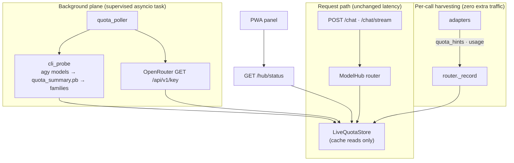

# Architecture — Live Quota per Provider for the Model Hub
**Project:** cloud-agy-orchestrator · **Feature:** Live per-provider quota (Model Hub extension)
**Author:** 🏗️ Winston (BMAD architect) · **Date:** 2026-10-21 · **Status:** Ready for dev
**Inputs:** `_bmad-output/brief-live-quota/brief.md` · `_bmad-output/prd-live-quota/prd.md` · `_bmad-output/architecture-model-hub/architecture.md` · `agent-service/hub/` (live, read) · `agent-service/main.py` (live, read) · `agent-service/agy-wrapper.sh` (live, read)

**Epic order (locked): C → A → B.** This doc designs all three; each epic is independently shippable.

---

## 1. Design paradigm (extends Epic 1)

**Advisory telemetry beside the enforcement path, never inside it.** Epic 1 built a policy router whose skip decisions come from circuit breakers, caps, and 429 signals. This feature adds a *parallel* live-quota telemetry plane: a supervised background poller/probe writes best-available quota facts into a dedicated store; the router reads that store as a *hint* (AGY family ordering only, per the locked auto-skip decision); `/hub/status` and the PWA render it. Enforcement semantics (AD-5: 429 is the universal exhaustion signal) are unchanged — live quota can make the router *smarter* about Tier 0, but it can never make a tier *less* available than the breaker logic already allows, except for the explicitly locked AGY family auto-skip.

Corollaries:
- Every new field is **additive** to `/hub/status` (PRD FR-4.1). Existing fields stay byte-identical; the current PWA panel keeps working if the new block is absent.
- Quota I/O **never blocks a chat request** (PRD FR-1.2/FR-3.6). The request path does cache reads only; all subprocess/HTTP quota work happens in one supervised background task.
- **Honesty is a type, not a label.** `quota_source` is a four-way enum (`live|headers|measured|estimated`), and staleness downgrade is computed at read time from `quota_updated_at` — a stale value *cannot* be presented as live, by construction (AC-3).

---

## 2. Architecture decisions (the invariants — continue Epic 1's AD-1…AD-8)

### AD-9 — Four-way `quota_source`: `live | headers | measured | estimated` [ADOPTED]
Reconciles the brief/PRD three-way split. `live` = polled from a provider API (OpenRouter) or the on-device CLI probe (AGY). `headers` = harvested from real response headers (Groq). `measured` = locally accumulated accounting we computed ourselves (AI Studio token counts, Requesty spend) — honest, but not "remaining quota". `estimated` = static config cap + local request counter (today's display). The split matters because Amin will read these numbers as truth: `measured` must never be mistaken for a provider telling us what's left.
*Binds:* every rendered quota number carries its source; the PWA badges all four. *Prevents:* "estimated" numbers wearing a "live" badge.

### AD-10 — Live-quota state lives in a dedicated in-memory `LiveQuotaStore`, per instance [ADOPTED]
New module `hub/live_quota.py`. It holds *display/advisory* state (last poll values, harvested headers, token/spend counters, probe families). Enforcement state (daily caps, RPM pacing, spend ledger) stays in `hub/quota.py` untouched. One home for quota facts keeps the read-time staleness computation (AD-17) in a single pure function and keeps quota.py's contract ("caps and pacing") crisp.
*Binds:* nothing outside `live_quota.py` computes an effective `quota_source`. *Prevents:* staleness logic drifting between payload, router, and panel.

### AD-11 — One supervised in-process asyncio task runs poller + probe; no Cloud Scheduler [ADOPTED]
A single background task, started in the FastAPI lifespan, runs the OpenRouter poll coroutine and the CLI probe coroutine on their cadences. Each provider's work is wrapped in try/except; a failure sets that provider's `poller.healthy=false` and logs loudly — the task itself never dies. Cloud Run scale-to-zero means it only runs on warm instances; `quota_updated_at` makes that staleness visible (NFR-5), which is the documented trade-off.
*Rejected:* Cloud Scheduler + trigger endpoint — new infra, new IAM, new HTTP surface, for a 10-minute advisory poll. Reconsider only if max-instances grows past 2 or Amin wants polling while scaled to zero.
*Binds:* NFR-2 (poller exceptions never reach handlers). *Prevents:* a new billable moving part.

### AD-12 — `quota_summary.pb` is decoded with a generic protobuf wire-format walker; no vendored schema [ADOPTED]
The CLI's quota cache has no published schema, and reverse-engineering a `.proto` is PRD-out-of-scope. Protobuf's wire format is self-describing enough: a ~50-line dependency-free walker yields `(field_number, wire_type, value)` triples; bucket submessages are identified structurally (length-delimited fields containing string fields); the bucket→family map comes from the config taxonomy matched against the bucket-name string. Which numeric field is `quota_remaining` vs a limit is confirmed once against a real Cloud Run capture at build time and recorded in config (`quota.providers.agy.pb_field_roles`) plus a fixture — not guessed.
*Rejected:* (a) vendored `.proto` — we'd be inventing a schema for a binary we don't control; (b) text-only `/usage` parsing as primary — less precise, and `/usage` may not expose per-bucket resets. `/usage` stays the *fallback* (FR-3.5c), which is the right seniority for it.
*Binds:* the parser never imports a CLI-specific schema; unknown fields are ignored, never fatal.

### AD-13 — Probe cache path is resolved by ordered candidate search, newest-mtime wins [ADOPTED]
Candidates: `$AGY_STATE_DIR`, `/root/.gemini/antigravity-cli/`, `/root/.gemini/antigravity/`, `$HOME/.gemini/antigravity-cli/` — glob `**/quota_summary.pb`, take newest. The confirmed path is logged at INFO on every probe run (visible, auditable). The dev agent records the real path on the first Cloud Run run and hardens the order if needed.
*Prevents:* a silent wrong-file read if the CLI ever moves its state dir.

### AD-14 — Probe runs `agy models` first (triggers the CLI's startup quota refresh), then reads the cache; 60s initial tick, then 10-min cadence; never on the request path [ADOPTED]
Per the brief's binary verification, `doRefreshQuota` runs on CLI startup when logged in — so the probe's `agy models` invocation *is* the refresh trigger, and the subsequent cache read sees fresh data. Slight refinement of the PM's "wait for the first tick": the first tick fires 60s after startup (jittered), not a full 10 minutes later — one bounded subprocess call, and the panel goes live faster after deploys/restarts. The probe's subprocess argv allowlist is exactly `{agy models, agy --print /usage, agy --print /credits}` — no `-p`/`--prompt` ever (AC-11 static test). Timeout 30s; non-zero exit → keep previous value, tier degrades to `estimated`, loud log.
*Binds:* FR-3.6/FR-3.7. *Prevents:* quota-check traffic ever burning AI credits.

### AD-15 — AGY families reuse `CircuitBreaker` with composite keys `agy:<family>`; auto-skip is locked on [ADOPTED]
A second `CircuitBreaker` instance (`ModelHub._family_breaker`, thresholds from config `quota.family_breaker`, defaults 3/600/900) tracks per-family exhaustion from family-aware error parsing. The router orders Tier-0 families closed-first and skips open families entirely (Amin's locked auto-skip=yes). All families open → whole-tier skip (`skip: all_families_open`). Unparseable output → legacy whole-tier behavior (FR-3.3), never a crash.
*Binds:* a dry Claude family can never block a healthy Gemini family. *Prevents:* the screenshot's exact failure mode (23% Gemini quota abandoned because Claude hit 0%).

### AD-16 — v1 harvested quota is display-only for skip decisions; 429 stays the hard signal [ADOPTED]
Groq `remaining-requests: 0` (or any harvested zero) does **not** pre-open breakers in v1 — it renders, and it's logged, but skip decisions stay with breakers/caps/429 (AD-5 unchanged). Rationale: Groq headers are per-*model* while tiers hold multiple models; min-across-models is an approximation, and a false skip costs more than one wasted attempt. Breaker integration is an explicit v2 candidate, not a silent behavior change now. (Answers PM Q4 with the PM's own recommendation.)
*Prevents:* approximate telemetry causing false tier skips.

### AD-17 — Staleness downgrade is computed at read time in `LiveQuotaStore.snapshot()` [ADOPTED]
`snapshot(now, staleness_s)` maps every stored value to its *effective* `quota_source`: older than the threshold ⇒ `estimated` (with the last live value's age noted in `detail`). Pure function of (stored value, now, threshold) — property-testable with a frozen clock (AC-3). The store never rewrites history; presentation downgrades, storage doesn't.
*Binds:* NFR-3. *Prevents:* a frozen "live" number surviving a dead poller.

### AD-18 — Header/accounting capture funnels through `router._record`, not per-adapter call sites [ADOPTED]
Adapters keep doing what they do (parse into `AdapterResponse.quota_hints` / `usage`); the router's `_record` — the single funnel for both collect and stream paths — writes into the `LiveQuotaStore` (`record_headers` when hints non-empty; `account_tokens`/`account_spend` from `usage`). One insertion point, no missed paths (notably `run_stream`, which currently never surfaces headers — Epic B fixes that at the adapter, the store write stays in the router).
*Prevents:* a new adapter or code path silently dropping telemetry.

### AD-19 — OpenRouter `remaining_pct` derivation chain: spend-cap → free-RPD-cap → null+detail [ADOPTED]
1. Key has `limit`+`limit_remaining` (spend cap) ⇒ `100 * limit_remaining / limit`. 2. Else free-tier ⇒ `100 * (1 - requests_today / free_rpd_cap)` with `free_rpd_cap` from config (default 50; dev verifies 50 vs 1,000 against the stored key at build time and sets it). 3. Else `remaining_pct: null` + `detail` explaining why. Exact response fields verified at build time (PM Q1) — the parser tolerates the `/auth/key` alias shape.
*Binds:* no division by a missing denominator, ever.

---

## 3. Data model — the additive `live_quota` block

### 3.1 Per-tier block (added to each entry of `/hub/status` → `tiers[]`)

```json
"live_quota": {
  "quota_source": "live | headers | measured | estimated",
  "quota_updated_at": "2026-10-21T17:30:00Z | null",
  "remaining_pct": 23.0,
  "reset_in": "5d 6h",
  "detail": "per-family state below — Gemini healthy, Claude/GPT dry",
  "families": [ /* agy tier only; see §3.2 */ ]
}
```

Field rules:
- `quota_source` — effective source **after** the AD-17 staleness downgrade. Raw values are kept in the store; what the payload (and PWA) shows is always the honest one.
- `quota_updated_at` — ISO-8601 UTC of the last successful underlying signal (poll/probe/harvest/accounting write). `null` until the first one lands (cold start → every tier `estimated`, NFR-4).
- `remaining_pct` — `null` unless the provider actually tells us something remaining. Never synthesized from a cap we invented.
- `reset_in` — compact human string (`"5d 6h"`, `"42m"`, `"1h 5m"`), matching the screenshot's language Amin already reads. `null` when unknown.
- `detail` — one short human sentence. Always present; it is where "no public quota API" honesty lives.

### 3.2 AGY per-family rows (`live_quota.families`, agy tier only)

```json
"families": [
  {"id": "gemini", "label": "Gemini Models",
   "models": ["gemini-3.8-flash-high", "gemini-3.8-flash-medium"],
   "circuit": "closed", "remaining_pct": 23.0, "reset_in": "5d 6h",
   "quota_source": "live", "quota_updated_at": "2026-10-21T17:30:00Z", "note": ""},
  {"id": "claude_gpt", "label": "Claude and GPT models",
   "models": ["claude-sonnet-4.6"], "circuit": "open",
   "remaining_pct": 0.0, "reset_in": "5d 12h",
   "quota_source": "live", "quota_updated_at": "2026-10-21T17:30:00Z",
   "note": "weekly limit exhausted"},
  {"id": "argon", "label": "Gemini Argon-class",
   "models": [], "circuit": "open",
   "remaining_pct": 0.0, "reset_in": "5d 23h",
   "quota_source": "live", "quota_updated_at": "2026-10-21T17:30:00Z",
   "note": "weekly limit exhausted"}
]
```

Tier-level `live_quota` for agy: `quota_source` = `live` iff the probe succeeded within the staleness window (else `estimated`); `remaining_pct` = min across families with non-null pct (the binding constraint on "can Tier 0 serve at all"); `reset_in` = the reset of that binding family; `detail` summarizes. Buckets the probe can't map to any family appear in `live_quota.unmapped_buckets[]` (`{name, remaining_pct, reset_in}`) — visible, never silently dropped (this is the "check all its models" requirement carried through honestly).

### 3.3 Per-provider semantics

| Tier | `quota_source` (fresh) | `remaining_pct` | `reset_in` | `detail` (typical) |
|---|---|---|---|---|
| agy | `live` (probe) | min family pct | binding family's reset | per-family summary; probe failures → `estimated` + reason |
| aistudio | `measured` | `null` | `null` | `"1,240 req · 380k tokens today (est. cap 1,500 RPD gemini-2.5-flash)"` |
| groq | `headers` | min over models of `remaining-requests/limit-requests` | from `x-ratelimit-reset-requests` | `"headers as of …"`; no headers yet → `estimated` |
| nvidia | `estimated` | `null` | `null` | `"no public quota API — 429-driven breaker is the protection"` |
| openrouter | `live` | AD-19 chain | from `limit_reset` | `"key poll as of …"`; poll failing → `estimated` |
| requesty | `measured` | `null` | `null` | `"$0.42 today · 38/200 free req (est.)"` |
| xai | n/a | n/a | n/a | tier disabled (unchanged) |

### 3.4 Precedence and merge rules (with today's static display)

- `live_quota` never replaces `daily_request_cap` / `requests_today` — those fields stay byte-identical (PRD FR-4.1). The PWA shows the live block as the primary number and keeps the static cap as the "plan" reference.
- Effective source precedence for *display*: `live` > `headers` > `measured` > `estimated`. A tier has exactly one writer per source class, so conflicts can't arise; the precedence only matters for the badge when multiple signals exist (e.g. Groq could later gain a poll API — the poll would win).
- Per-provider `quota_enabled: false` in config ⇒ the store ignores that tier's writes; snapshot reports `estimated` + `detail: "live polling disabled in config"` (PRD FR-6.2).
- Staleness threshold: config `quota.staleness_s` (default 1800). Older than threshold ⇒ effective `estimated`, `detail` gains `"(last live reading 42m ago)"`. The raw value is retained for the next successful refresh to overwrite.

---

## 4. Component design

### 4.1 Module layout (new code under `agent-service/hub/`)

```text
hub/
  live_quota.py      # NEW (Epic C skeleton, filled across C→A→B): LiveQuotaStore —
                     #   set_probe_result / set_poll_result / record_headers /
                     #   account_tokens / account_spend / set_families / snapshot()
  cli_probe.py       # NEW (Epic C): probe_available(), run_probe(), decode_quota_summary(),
                     #   parse_agy_models(), derive_taxonomy(), PROBE_ARGV_ALLOWLIST
  quota_poller.py    # NEW (Epic A; probe scheduling lands in C): start(model_hub),
                     #   supervised asyncio task, per-provider coroutines + health
  signals.py         # EXTEND (Epic C): agy_family_of(), family marker tables (from config)
  breaker.py         # REUSE (Epic C): second CircuitBreaker instance for families (no code change —
                     #   composite keys "agy:<family>"; thresholds from config)
  router.py          # EXTEND (C: family ordering + _record hooks; B: usage accounting hooks)
  quota.py           # UNCHANGED (caps/pacing/spend ledger stay enforcement-only, AD-10)
  observability.py   # EXTEND (A): status_payload gains live_quota per tier + top-level poller
  types.py           # EXTEND (A): QuotaSettings pydantic model for the new config block
  adapters/
    openai_compat_adapter.py  # EXTEND (B): capture response headers on run_stream too;
                              #   extract usage.cost → usage["cost_usd"]; stream_include_usage flag
    gemini_adapter.py         # UNCHANGED (usage already returned; router accounts it in B)
```



### 4.2 `LiveQuotaStore` (`hub/live_quota.py`)

In-memory, per instance (consistent with breaker/quota). All mutations guarded by an `asyncio.Lock` (cheap hygiene; writers are the poller task and the router, same loop).

```python
class LiveQuotaStore:
    async def set_probe_result(self, families: list[FamilyQuota], at: datetime) -> None
    async def set_poll_result(self, tier_id: str, remaining_pct: float | None,
                              reset_in: str | None, detail: str, at: datetime) -> None
    async def record_headers(self, tier_id: str, model: str, headers: dict, at: datetime) -> None
    async def account_tokens(self, tier_id: str, input_tokens: int, output_tokens: int) -> None
    async def account_spend(self, tier_id: str, usd: float) -> None
    async def set_poller_health(self, provider: str, healthy: bool, at: datetime | None) -> None
    def snapshot(self, cfg: HubConfig, now: datetime, staleness_s: int) -> dict
    # snapshot() -> {"tiers": {tier_id: <live_quota block>},
    #               "poller": {"healthy": bool, "last_run": iso|None,
    #                          "providers": {name: {"healthy": bool, "last_run": iso|None}}}}
```

`snapshot()` is where AD-17 lives: for each tier it picks the freshest available signal class, applies the staleness downgrade, and builds the §3 block. Pure enough to property-test with a frozen clock (AC-3). Date-keyed counters (`tokens_today`, `spend_today`, per-tier `requests` already in QuotaTracker) roll on UTC day boundary, computed at read time — no midnight cron needed.

### 4.3 `signals.py` — family-aware parsing (Epic C)

```python
def agy_family_of(model_name: str, output_text: str, families: dict) -> str | None:
    """model-name substring match first, then family marker strings in CLI output."""
```

- Family taxonomy comes from config (`quota.providers.agy.families`: `{id: {match: [...], label: ...}}`), hot-loaded like everything else (AD-4). The probe's runtime model list is authoritative for *which models exist*; the config `match` rules assign them to families. A model matching nothing → family `"other"` (still attempted, still displayed).
- Family marker strings (e.g. output mentioning a Claude model name on an exhausted run) also live in config, not code — CLI error strings change; config edits don't need deploys (brief §8 risk, mitigated).
- Existing `agy_exhausted()` / `agy_outcome()` are untouched; family parsing is a refinement layer *after* an EXHAUSTED classification.

### 4.4 Router integration (Epic C + B)

**Tier-0 family ordering (Epic C, locked auto-skip=yes):**
- `_family_models(tier, request)`: group the tier's model list by family — probe taxonomy first, config seed second, single `"default"` family when the probe never ran (exactly today's behavior).
- Walk families closed-first (config family order), open families skipped silently-but-recorded (`skip: family_circuit_open`). All open → record `skip: all_families_open`, advance tier.
- On EXHAUSTED from an agy model: `family_breaker.note_exhaustion("agy:<family>")` (in addition to the existing whole-tier `note_exhaustion(tier.id)` at tier end — kept for the legacy path and the all-open case). On SUCCESS: `note_success` on both.
- `requested_model_override` still pins first (existing `_models_for_tier` behavior preserved; the override's family is inferred the same way).

**Telemetry hooks (Epic B, via AD-18):** in `_record`, after the existing `quota_hints` bookkeeping:
```python
if attempt.quota_hints:
    await self._live_quota.record_headers(tier.id, model, attempt.quota_hints, now)
usage = attempt.usage or {}
if usage.get("input_tokens") is not None:
    await self._live_quota.account_tokens(tier.id, usage["input_tokens"], usage.get("output_tokens", 0))
if usage.get("cost_usd"):
    await self._live_quota.account_spend(tier.id, usage["cost_usd"])
```
Cost: two dict writes per attempt — unmeasurable against a model call (NFR-1).

**`status()`**: passes `live_quota=self._live_quota.snapshot(cfg, now_utc(), cfg.quota.staleness_s)` into `status_payload`. The poller task is reachable via the `ModelHub` instance (created in `quota_poller.start(model_hub)`).

### 4.5 `/hub/status` payload (Epic A; families shape lands in C)

Existing fields byte-identical; additions only:

```json
{
  "config_version": 1, "config_source": "secret-manager",
  "tiers": [ { /* ...existing 12 fields... */,
               "live_quota": { /* §3.1 (+ families for agy, §3.2) */ } } ],
  "poller": {"healthy": true, "last_run": "2026-10-21T17:30:00Z",
             "providers": {"openrouter": {"healthy": true, "last_run": "..."},
                           "agy_probe": {"healthy": true, "last_run": "..."}}},
  "paid": { /* unchanged */ }, "breaker": { /* unchanged */ }
}
```

Full shape documented in `docs/hub-status-contract.md` (new file, PRD FR-4.4) with a contract test asserting it (AC-3).

---

## 5. `cli_probe` deep dive (Epic C — first)

### 5.1 What it does, in order

```
probe_available()?
  ├─ no  → return None  (local dev / CI: no-op; Tier 0 uses error parsing)
  └─ yes →
      1. run ["agy", "models"] (30s timeout) → triggers doRefreshQuota on CLI startup
      2. parse model list → derive_taxonomy() → model→family map
      3. find newest quota_summary.pb via AD-13 candidate search
      4. decode → per-bucket {name, remaining_pct, reset_in} → map to families
      5. no cache / stale cache / decode failure → ["agy", "--print", "/usage"] text fallback
      6. write LiveQuotaStore.set_probe_result() with quota_source="live"
```

Environment: `HOME=/root`, cwd a temp dir (no repo needed — quota is account-level, not session-level). Token location: the container-global copy `/root/.gemini/antigravity-cli/antigravity-oauth-token`, which `agy-wrapper.sh` guarantees when the container is authenticated; `probe_available()` uses the wrapper's exact check order (`/mnt/cache/antigravity-oauth-token` → `/root/.gemini/...` → `$AGY_OAUTH_TOKEN`) plus `shutil.which("agy")`.

### 5.2 Protobuf decode strategy (answers PM Q6)

`decode_quota_summary(pb: bytes, field_roles: dict | None) -> list[RawBucket]`:

1. **Wire walk** (~50 lines, dependency-free): iterate `(field_number, wire_type, value)`; wire type 0 → varint int; wire type 2 → bytes (recurse once for submessages; try UTF-8 decode for strings). Other wire types skipped. Malformed input → return `[]`, never raise.
2. **Bucket assembly**: top-level length-delimited fields are candidate buckets; if a candidate has no string fields but has submessages, descend one level (handles a `response { repeated buckets }` wrapper). Per bucket: `strings[]`, `varints[]` (in field-number order).
3. **Name resolution**: the string whose lowercase form contains any family `match` substring → that family. No match → `unmapped_buckets[]` entry (still reported, §3.2).
4. **Numeric roles**: `field_roles` (config `quota.providers.agy.pb_field_roles`, e.g. `{"remaining": 1, "limit": 5, "resets_at_epoch": 3}`) maps field numbers to meaning. `remaining_pct` = `100 * remaining / limit` when both present and `limit > 0`; if only `remaining` is present and it already reads as a percent (0–100 with a sibling bucket at 23 matching the IDE screenshot), the build-time verification decides the formula and documents it in the fixture. `reset_in` derived from the resets field (epoch → `"5d 6h"` formatting helper, shared with the PWA's expectations).
5. **`field_roles: null`** (before build-time verification) → buckets returned raw, `remaining_pct: null`, `detail: "quota cache found; field mapping pending verification"` — honest, never guessed.

**Build-time verification (dev's job, on Cloud Run):** run the probe once with a debug dump of the raw decode; compare the extracted numbers against the IDE usage page semantics (Gemini ≈23%); record the confirmed `field_roles` in config + a `RawBucket` fixture in tests. AC-9's test then feeds recorded protobuf bytes (hand-crafted wire-format in the test — legitimate, since the parser is wire-format-generic) and asserts the mapping.

### 5.3 `agy models` parsing & taxonomy

The dev agent records the real `agy models` output on the first authenticated Cloud Run run and writes the parser against that fixture (AC-8: the test asserts the mapping *from the fixture*, no hardcoded list in the assertion). Expected shape: one model per line, likely `name — description`; the parser takes the first token per non-empty line, strips decoration. `derive_taxonomy(models, family_rules)`: lowercase model → first family whose any `match` substring appears; else `"other"`.

### 5.4 Cost & safety guards (FR-3.6/FR-3.7, AC-10/AC-11)

- `PROBE_ARGV_ALLOWLIST` constant; every probe invocation asserts membership. AC-11: static test imports the constant and fails the build if any argv contains `-p`, `--prompt`, or anything outside the three allowed forms.
- 30s timeout per invocation; `subprocess.run` via `asyncio.to_thread` (mirrors `AgyAdapter.run`); TimeoutExpired / non-zero exit → keep previous store value, tier degrades to `estimated`, `poller.providers.agy_probe.healthy=false`, loud log. Chat path never waits on it.
- The probe sends no prompt, makes no model call, and performs no mutation — it is strictly inspection. The only network traffic is the CLI's own startup quota refresh (a free summary RPC the CLI performs anyway when invoked).

### 5.5 Cold start & scale-to-zero

Cold start: store empty → Tier 0 `estimated` with families from the config seed (circuit states only). First probe tick at 60s post-startup (AD-14), then every 600s. Scale-to-zero: no probe while no instance is warm; `quota_updated_at` exposes the gap (NFR-5). The PM's "acceptable for v1" stands — the 60s initial tick is the only refinement, and it costs one bounded subprocess call.

---

## 6. Background poller — OpenRouter (Epic A)

`quota_poller.py::start(model_hub)` — called from the FastAPI lifespan (new `@asynccontextmanager lifespan` in `main.py`; the app currently has none). One `asyncio.create_task`; graceful cancel on shutdown.

Loop sketch:
```python
async def _supervisor():
    await asyncio.sleep(initial_delay_s)          # 60s, jittered
    while True:
        await asyncio.gather(openrouter_poll(), agy_probe_run(), return_exceptions=True)
        await asyncio.sleep(interval_s)           # 600s
```
(One task, two coroutines — a failure in one never starves the other; `return_exceptions=True` plus per-coroutine try/except → `set_poller_health(provider, False, …)`.)

**OpenRouter poll** (144/day of the 500/day account budget):
- `GET {key_url}` (`https://openrouter.ai/api/v1/key`, config-overridable), `Authorization: Bearer $OPENROUTER_API_KEY`, 20s timeout, via httpx (already a dependency).
- Parse per AD-19; write `set_poll_result("openrouter", …)` with `quota_source="live"`.
- On 429/402: exponential backoff (×2, cap 1h), tier downgrades to `estimated` — the check never burns the budget it's measuring (PRD FR-7.4).
- Poll cadence, URL, and `free_rpd_cap` are config (FR-6.1); `quota_enabled: false` skips the coroutine entirely.

**Health**: `poller.providers.<name> = {healthy, last_run}`; top-level `healthy` = AND over enabled providers. The PWA shows a subtle warning when false (FR-5.3) — never a blocking error.

---

## 7. Header harvesting — Groq (Epic B)

**Insertion point** (AD-18): `router._record` — both `execute()` and `execute_stream()` already funnel `quota_hints` there. The only adapter change: `OpenAICompatAdapter.run_stream` must capture response headers on the success path (today it doesn't — headers are available on the `resp` object right after `client.stream(...)` enters; the dev adds `quota_hints=parse_quota_hints(dict(resp.headers))` to the success `AdapterResponse`).

**Store semantics** (`record_headers`): per-tier dict `model → {limit_requests, remaining_requests, limit_tokens, remaining_tokens, reset_requests, reset_tokens, at}`. Defensive: missing/renamed headers ignored; a *new* `x-ratelimit-*` variant logs one line per process lifetime (dedup set — answers PM Q5: log volume is O(variants), not O(requests)). Tier `remaining_pct` = min over models with fresh (within staleness) data of `remaining_requests / limit_requests`; `reset_in` from the corresponding `reset_requests`. No fresh data → `estimated`.

**Thread-safety**: writers are the router (asyncio loop) and the poller task (same loop) — an `asyncio.Lock` in the store makes the invariant explicit and costs nothing.

**NVIDIA watch**: the same harvesting path already records whatever `x-*` headers NVIDIA sends into `quota_hints` (raw, visible in the payload). If undocumented quota headers appear, the tier reclassifies from `estimated` to `headers` with a config-only change — no code deploy. (This is the brief's "capture and log all response headers on first integration" made structural.)

---

## 8. Per-call accounting — AI Studio & Requesty (Epic B)

- **AI Studio**: `GeminiAdapter` already returns `usage{input_tokens, output_tokens}` from `usageMetadata`. Router `_record` → `live_quota.account_tokens("aistudio", …)`. Display: `measured`, `remaining_pct: null`, `detail: "{req} req · {tok} tokens today (est. cap {rpd} RPD)"` using the tier's `model_limits_rpd` for the primary model.
- **Requesty**: `OpenAICompatAdapter` usage extraction extended to read `usage.cost` → `usage["cost_usd"]` (Requesty returns per-call USD cost; streaming needs `stream_options: {"include_usage": true}` — new tier config flag `stream_include_usage`, default false, enabled for requesty in config). Router → `account_spend("requesty", …)`. Display: `measured`, `detail: "${spend} today · {req}/200 free req (est.)"`.
- **Storage**: in `LiveQuotaStore`, date-keyed (UTC) dicts — same rollover pattern as `QuotaTracker._daily_counts`; no new files, no GCS. (The paid `SpendLedger` stays xAI-only; free-tier spend display is informational, not a gate — AD-7's triple gate is untouched.)

---

## 9. PWA status panel (additive)

The existing panel (shipped: per-tier cards from `tiers[]`) gains, with zero changes to current rendering:
1. Per-tier source badge from `live_quota.quota_source`: `live` (green) / `headers` (blue) / `measured` (teal) / `estimated` (gray) + `"as of HH:MM"` from `quota_updated_at` (`"—"` when null).
2. The quota number line prefers `live_quota` (`remaining_pct` + `reset_in` + `detail`); falls back to today's `requests_today / daily_request_cap` rendering when `live_quota` is absent (backward compatible with any cached old payload).
3. AGY card renders `live_quota.families[]` rows (family label, % or circuit state, reset note) — the screenshot's three rows, plus any `unmapped_buckets[]` as extra rows.
4. `poller.healthy === false` → subtle ⚠️ dot on affected tier cards; panel never blocks on it (FR-5.3).
5. No new auth, no secrets displayed (FR-5.4; the endpoint returns none — the AC-10/`no_secret_leak` test is extended to the new block, NFR-6).

---

## 10. Config schema — additions to `MODEL_HUB_CONFIG`

```json
"quota": {
  "staleness_s": 1800,
  "poller_interval_s": 600,
  "probe_interval_s": 600,
  "probe_initial_delay_s": 60,
  "family_breaker": {"exhaustions_to_open": 3, "window_s": 600, "cooldown_s": 900},
  "providers": {
    "openrouter": {"quota_enabled": true,
                   "key_url": "https://openrouter.ai/api/v1/key",
                   "free_rpd_cap": 50},
    "groq":       {"harvest_enabled": true},
    "aistudio":   {"accounting_enabled": true},
    "requesty":   {"accounting_enabled": true, "stream_include_usage": true,
                   "free_rpd_cap": 200},
    "nvidia":     {"harvest_enabled": true},
    "agy": {"probe_enabled": true,
            "pb_field_roles": {"remaining": 1, "limit": 5, "resets_at_epoch": 3},
            "families": {
              "gemini":     {"label": "Gemini Models",         "match": ["gemini"]},
              "claude_gpt": {"label": "Claude and GPT models", "match": ["claude", "gpt"]},
              "argon":      {"label": "Gemini Argon-class",    "match": ["argon"]}
            },
            "family_markers": {
              "claude_gpt": ["claude", "anthropic"],
              "argon": ["argon"]
            }}
  }
}
```

Validated by a new `QuotaSettings` pydantic model (`hub/types.py`); `extra="ignore"` like the rest, so old configs keep working. Everything hot-loaded (AD-4) — Amin retunes cadences/taxonomy with zero redeploy. `pb_field_roles: null` until the build-time Cloud Run verification (§5.2).

---

## 11. Security & privacy

- The probe runs **the user's own CLI with the user's own OAuth token inside the user's own container** — the same trust domain as every `/chat` call today. No new credential, no new secret handling, no token ever leaves the process (it isn't even passed explicitly; the CLI reads its standard state dir).
- `/hub/status` stays secret-free: `live_quota` carries percentages, timestamps, and booleans — no key material, no token, no bucket internals beyond names. The `test_no_secret_leak.py` suite is extended to the new payload (NFR-6, AC-10 lineage).
- AC-11's static argv test is a security control, not just a correctness one: it proves at build time that the probe cannot be repurposed into prompt execution.
- PWA displays nothing that isn't already in the (public-readable, secret-free) status payload.

---

## 12. Test strategy (maps to PRD AC-1…AC-11)

| AC | Test | How |
|---|---|---|
| AC-1 | OpenRouter fixture parse | recorded `GET /api/v1/key` JSON → `live_quota{source:live, remaining_pct, reset_in}`; no network |
| AC-2 | Groq header harvest | recorded header set → `remaining_pct`/`quota_updated_at` update; missing headers → previous value kept |
| AC-3 | Status contract + staleness | every tier has `live_quota` with source ∈ 4 enum values; **property test** with frozen clock: older-than-threshold ⇒ never `live`/`headers`/`measured` |
| AC-4 | Per-family breaker | recorded exhausted-output samples per family → only that family's breaker opens; Tier 0 skipped only when all open |
| AC-5 | Poller failure | simulated 429 on poll → `estimated` + `poller.providers.openrouter.healthy=false`; no exception reaches handlers |
| AC-6 | PWA fixture render | fixture payload → badges, "as of", family rows; fetch failure keeps old data (existing regression test extended) |
| AC-7 | Latency | p99 `/chat` within 5% of pre-feature baseline (quota = cache reads + dict writes) |
| AC-8 | `agy models` fixture | recorded CLI output → correct model→family map; assertion derives from fixture, no hardcoded list |
| AC-9 | Quota-summary fixture | hand-crafted protobuf wire bytes (+ `/usage` text fixture) → per-family `live_quota{source:live, remaining_pct, reset_in}`; `families[]` rows match |
| AC-10 | Probe failure | simulated timeout/non-zero exit → `estimated`, probe `healthy=false`, chat unaffected |
| AC-11 | **Static argv guard** | test imports `PROBE_ARGV_ALLOWLIST`, asserts no argv contains `-p`/`--prompt`/any other subcommand |
| — | No secret leak (ext.) | full new payload through `no_secret_leak` — percentages/timestamps only |

New tests live in `hub/tests/` beside the existing suite; CI already runs `pytest` there (no new billable services).

---

## 13. Dev-agent handoff — epic/story breakdown (locked order C → A → B)

**Epic C — AGY per-family state + live CLI probe** (FIRST, closest to Amin's screenshot)
- C-S1: `hub/live_quota.py` — store skeleton: families, `set_probe_result`, `snapshot()` with staleness downgrade, `poller` health block.
- C-S2: `hub/cli_probe.py` — `probe_available()`, `run_probe()`, wire-format `decode_quota_summary()`, `parse_agy_models()`, `derive_taxonomy()`, `PROBE_ARGV_ALLOWLIST`; fixtures for `agy models` + hand-crafted pb bytes + `/usage` text.
- C-S3: `hub/signals.py` — `agy_family_of()` + config-driven family markers; family taxonomy seed in `DEFAULT_LADDER`'s `quota` block.
- C-S4: `hub/router.py` — family grouping/ordering for Tier 0, composite-key family breaker (second `CircuitBreaker` instance), auto-skip open families, `skip: all_families_open`; `_record` unchanged in C.
- C-S5: `hub/observability.py` — `live_quota` block incl. `families[]`/`unmapped_buckets[]` in `status_payload`.
- C-S6: `main.py` — FastAPI lifespan starts the poller task (probe coroutine only in C; poll stubbed); graceful shutdown.
- C-S7: Build-time Cloud Run verification run: real `agy models` capture → parser fixture; real `quota_summary.pb` capture → `field_roles` + fixture (record the confirmed cache path).
- C-S8: Tests AC-4, AC-8, AC-9, AC-10, AC-11; `docs/hub-status-contract.md` v1.
- C-S9: PWA — AGY `families[]` rows (additive).

**Epic A — OpenRouter live poll + status shape** (SECOND, proves the pipeline on a real HTTP API)
- A-S1: `hub/quota_poller.py` — OpenRouter coroutine (poll, parse per AD-19, backoff), `key_url` config, budget accounting (144/day).
- A-S2: `LiveQuotaStore.set_poll_result` + `set_poller_health`; top-level `poller` block in payload.
- A-S3: Tests AC-1, AC-3 (contract), AC-5; `no_secret_leak` extension.
- A-S4: PWA — source badges + "as of" timestamps (additive).

**Epic B — Header harvesting + per-call accounting** (THIRD, zero new network calls)
- B-S1: `OpenAICompatAdapter.run_stream` header capture; `stream_include_usage` flag; `usage.cost` → `cost_usd` extraction.
- B-S2: `router._record` → `record_headers` / `account_tokens` / `account_spend` (AD-18).
- B-S3: `LiveQuotaStore` per-model header state, min-across-models pct, token/spend counters; `measured` rendering rules (§3.3).
- B-S4: Tests AC-2, AC-6, AC-7; PWA measured values.

Each epic: branch → PR → merge with Amin's tap (standing rule). No epic changes ladder order, capability modes, or Epic 1 failover semantics.

---

## 14. Deployment & rollback

**No terraform changes.** No new secrets, no new IAM, no new infra (AD-11) — the poller/probe run inside the existing container with existing credentials.

**Deploy per epic:**
1. PR: code + `docs/hub-status-contract.md` → Amin's taps → merge.
2. Existing `deploy-agent-infra.yml` builds the image and applies (no-op terraform) → new Cloud Run revision.
3. `MODEL_HUB_CONFIG` gains the `quota` block (§10) — **hot-loaded, no redeploy needed**; dev supplies the exact JSON snippet in the PR description for Amin to paste (same pattern as Epic 1's ladder JSON).
4. Smoke: `GET /hub/status` → `live_quota` present per tier, `poller.healthy` true after ~60s, AGY `families[]` populated on Cloud Run; PWA panel shows badges.

**Epic C build-time verification** (C-S7) happens against the *deployed* revision: the dev agent (or Amin) triggers one probe cycle via the status endpoint's `quota_updated_at`, captures the real `agy models` output and `quota_summary.pb` decode, and records fixtures + `field_roles` — committed as a follow-up config/code tweak if the mapping needs it.

**Rollback:** previous Cloud Run revision (one command, <2 min); config rollback = previous `MODEL_HUB_CONFIG` version. The feature is strictly additive — rolling back the code leaves a valid Epic-1 payload (the PWA tolerates a missing `live_quota` block by design, §9.2).

---

## 15. Risks

| Risk | Status after this design |
|---|---|
| `quota_summary.pb` field layout differs from the brief's binary reading | Contained: wire-format decode never crashes on unknown layouts; `field_roles: null` ⇒ honest `detail` instead of guessed numbers; build-time capture confirms |
| CLI moves its state dir / renames the cache file | Contained: AD-13 candidate search + newest-mtime; confirmed path logged; worst case → `/usage` text fallback |
| `agy models` output format changes | Contained: line-oriented parser against a recorded fixture; unparseable → keep previous taxonomy + loud log |
| Probe subprocess hangs the loop | Contained: 30s timeout, `asyncio.to_thread`, never on request path; supervision boundary |
| OpenRouter poll eats the 500/day budget | Contained: 144/day, backoff on 429, `quota_enabled` kill-switch in config |
| Stale "live" badge misleads Amin | Neutralized by construction: AD-17 read-time downgrade + always-rendered "as of" |
| Scale-to-zero staleness | Accepted + visible (NFR-5); documented, not hidden |
| Family error strings change with CLI updates | Mitigated: markers in hot-loaded config, unknown output → legacy whole-tier behavior |
| Scope creep (breaker integration for harvested signals) | Explicitly deferred to v2 (AD-16); v1 display-only |

---

## 16. PM open questions — resolved with recommendations

Per PRD §8, each gets a concrete answer (dev treats these as decided unless Amin objects):

1. **OpenRouter free-tier fields:** verify at build time against the stored key; derivation follows AD-19's chain (spend-cap → free-RPD-cap → null+detail). The parser tolerates the `/auth/key` alias shape.
2. **Poller hosting:** in-process supervised asyncio task (AD-11) — background thread on warm instances only. Lazy refresh on first request after cold start is **rejected**: it puts quota I/O adjacent to the request path and complicates the latency story for zero benefit (the 60s initial tick covers it).
3. **AGY family taxonomy:** probe-derived at runtime from `agy models`; config seed (`gemini`/`claude_gpt`/`argon` per the screenshot) for cold start; model→family mapping confirmed against the first real Cloud Run probe run (C-S7). Real exhausted-output samples captured opportunistically from the next real exhaustion — never burn quota to produce them.
4. **Groq zero → pre-open breaker?** No in v1: display-only (AD-16). Revisit in v2 with per-model breaker keys if the data proves reliable.
5. **Undocumented-header log volume:** dedup set — one log line per new header variant per process lifetime. O(variants), not O(requests).
6. **Protobuf decode strategy:** generic wire-format walker, no vendored schema (AD-12); runtime cache path via AD-13 candidate search; both confirmed on the first Cloud Run run.
7. **Cold-start probe:** PM's "estimated until first tick" stands, refined to a 60s initial tick (AD-14) — one bounded call, panel goes live faster after restarts.

---

*Next: BMAD dev agent implements Epic C per §13. PRD acceptance criteria AC-1…AC-11 map to the test rows in §12.*
