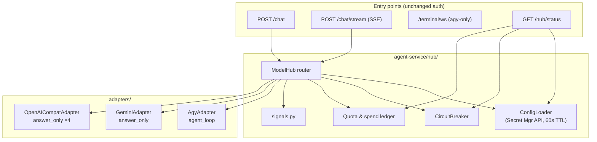
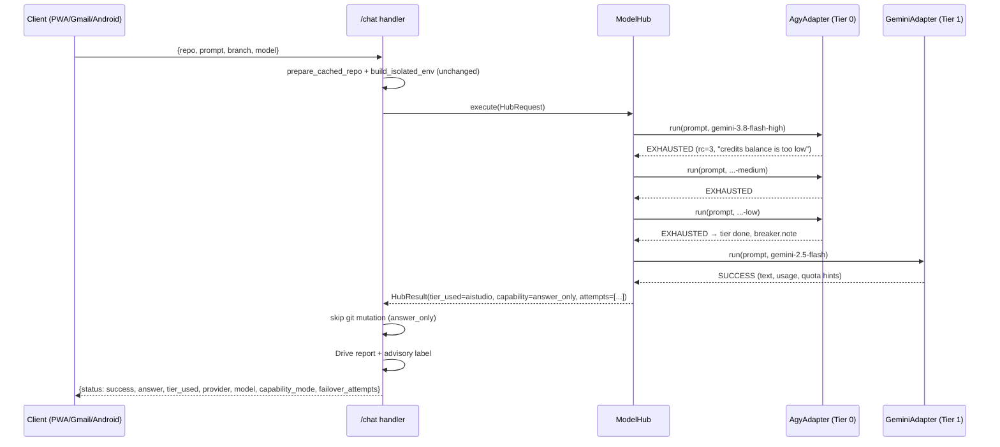

# Architecture — Model Hub with Priority Failover Chain
**Project:** cloud-agy-orchestrator · **Feature:** Model Hub
**Author:** Winston (BMAD architect) · **Date:** 2026-10-21 · **Status:** Ready for dev
**Inputs:** `_bmad-output/brief-model-hub/brief.md` · `_bmad-output/prd-model-hub/prd.md` · `agent-service/main.py` (1040 lines, read) · `agent-service/Dockerfile` · `agent-service/requirements.txt` · `agent-service/agy-wrapper.sh` · `terraform/main.tf` · `terraform/variables.tf` · `deploy/grant-sa-roles.sh`

---

## 1. Design paradigm

**A policy-driven router over a plugin adapter bus.** One `ModelHub` owns the priority ladder; every provider is a small adapter behind a single interface; all policy (tier order, models, caps, enable flags) is hot-loaded config, never code. The existing FastAPI handlers become thin: they prepare the repo workspace (unchanged), call the hub, then perform side effects **once** for the winning tier.

This keeps the brownfield reality intact: today's `/chat`, `/chat/stream`, PTY paths, `.agy_session` isolation, and commit/push flow are *extended, not rewritten* — the hub replaces only `ACTIVE_QUOTA_MODELS` / `resolve_model_candidates()` / the inline failover loops in the two chat handlers.

---

## 2. Architecture decisions (the invariants)

### AD-1 — One hub entry serves every entry point [ADOPTED]
`ModelHub.execute()` (collect) and `ModelHub.execute_stream()` (async generator) are the only ways to run a model task. `/chat`, `/chat/stream`, the Gmail bridge (via `/chat`), PWA, and Android inherit failover automatically. `/terminal/ws` stays `agy`-only (a PTY *is* the agy tier) and gets an honest exhaustion banner instead of fake failover (FR-5.3).
*Binds:* no handler may call `agy` or a provider SDK directly. *Prevents:* failover logic drifting per-client.

### AD-2 — Tier 0 keeps the existing agy subprocess path, generalized [ADOPTED]
The `AgyAdapter` reuses today's invocation (`agy -p … --mode accept-edits --dangerously-skip-permissions --model <m>`, PTY or pipe, isolated env from `build_isolated_env()`). The model list comes from config, not `ACTIVE_QUOTA_MODELS`. `is_credit_exhausted()` moves into `hub/signals.py` unchanged, extended with unknown-model markers.
*Binds:* NFR-7 (no regression when AGY is healthy). *Prevents:* a rewrite of the autopilot path.

### AD-3 — Fallback tiers are `answer_only` and structurally side-effect-free [ADOPTED]
`answer_only` is enforced in the adapter base class: those adapters expose no shell/file/git surface at all (they return text, period). Honesty is not a prompt instruction; it's an interface boundary (FR-3.3).
*Binds:* Epic 3's agent-loop adapter is a *new* adapter class, not a flag flip on an answer adapter. *Prevents:* a fallback tier ever mutating a repo.

### AD-4 — Config is hot-loaded from Secret Manager; code carries only the default ladder [ADOPTED]
`MODEL_HUB_CONFIG` (JSON) is fetched via the Secret Manager API with ADC at ≤60s TTL — **not** env-mounted — so Amin reorders tiers with zero redeploy (FR-2.2). Env vars remain the local/dev fallback. The baked `DEFAULT_LADDER` in code is the cold-start seed only.
*Binds:* no tier order, model list, cap, or enable flag may be hard-coded in handler logic. *Prevents:* "quick" code edits to tune the ladder.

### AD-5 — Exhaustion is a per-provider signal table; 429 is the universal fallback signal [ADOPTED]
Each adapter declares how it detects exhaustion (see §6). For all HTTP API tiers the design is **signal-agnostic**: any HTTP 429 ⇒ exhausted (this is what makes the NVIDIA credit ambiguity a non-issue). Auth failures (401/403) on *optional* tiers ⇒ warn + skip tier; on required tiers (0, 1) ⇒ surface as endpoint error. Malformed requests (400) ⇒ surface, never advance (FR-1.2).
*Binds:* adapters must map exceptions to `AttemptOutcome` enums, never raise provider SDK errors past the router (NFR-3).

### AD-6 — Side effects happen once, after the winner, and only for `agent_loop` [ADOPTED]
Repo mutation (git add/commit/push, GCS snapshot, Drive report) stays in the FastAPI handlers and runs **once** after `HubResult` returns — never inside an adapter, never per attempt (FR-1.5). `answer_only` winners skip mutation entirely.
*Binds:* adapters are pure with respect to the repo. *Prevents:* partial commits from failed attempts.

### AD-7 — Paid tiers are triple-gated [ADOPTED]
A paid tier fires only if: (a) its secret exists, (b) `paid.enabled: true` in config, (c) daily spend cap not reached. Default: all false/zero. Enabling requires Amin's funding tap (§8.4 of PRD) — no config-only path to spend money (FR-6.1).
*Prevents:* surprise charges by misconfiguration.

### AD-8 — Slim dependencies: httpx for OpenAI-compatible tiers, `google-genai` only for AI Studio [ADOPTED]
`httpx==0.27.2` is already in requirements — the OpenAI-compatible adapter is ~80 lines of httpx, no `openai` package (keeps the Tier-1 container layer slim, per the README's <100MB posture). Only new dependency: `google-genai` (native Gemini SDK, best function-calling for Epic 3).
*Prevents:* dependency bloat in the container image.

---

## 3. Component design

### 3.1 Module layout (all new code under `agent-service/hub/`)

```text
agent-service/
  main.py                        # thinned: handlers → hub; adds GET /hub/status; exhaustion banner in /terminal/ws
  requirements.txt               # + google-genai (only addition)
  hub/
    __init__.py                  # exports: ModelHub, HubRequest, HubResult, load_config
    types.py                     # TierConfig, ModelAttempt, HubResult, CapabilityMode, AttemptOutcome (pydantic)
    config.py                    # ConfigLoader: Secret Manager API (60s TTL) → env MODEL_HUB_CONFIG_JSON → DEFAULT_LADDER
    signals.py                   # per-provider exhaustion parsers (AGY markers, HTTP 429 tables)
    breaker.py                   # CircuitBreaker: per-tier consecutive-exhaustion state + cooldown
    quota.py                     # daily request caps, per-task budgets, RPM pacing, paid spend ledger (GCS-backed)
    secrets_provider.py          # Secret Manager API fetch w/ TTL (MODEL_HUB_CONFIG); thin wrapper over google-auth ADC
    observability.py             # attempt logging helper, /hub/status payload, Drive report footer, Gmail one-liner
    router.py                    # ModelHub: ladder walk, in-tier model failover, retry-on-Retry-After, event streaming
    adapters/
      __init__.py                # ADAPTER_REGISTRY = {"agy": AgyAdapter, "gemini": GeminiAdapter,
                                 #                     "openai_compat": OpenAICompatAdapter}
      base.py                    # ProviderAdapter ABC
      agy_adapter.py             # Tier 0 — generalized existing subprocess/PTY path
      gemini_adapter.py          # Tier 1 — google-genai SDK → generativelanguage.googleapis.com/v1beta
      openai_compat_adapter.py   # Tiers 2–5 — parameterized httpx client (base_url, key, headers, prices)
  tests/
    test_signals.py  test_router.py  test_breaker.py  test_config.py  test_quota.py  test_no_secret_leak.py
```



### 3.2 Provider adapter interface (`adapters/base.py`)

```python
class CapabilityMode(str, Enum):
    AGENT_LOOP = "agent_loop"
    ANSWER_ONLY = "answer_only"

class AttemptOutcome(str, Enum):
    SUCCESS = "success"
    EXHAUSTED = "exhausted"        # credits/quota gone → advance
    RETRYABLE_429 = "retryable_429" # 429 + usable Retry-After → one delayed retry, same model
    AUTH_FAULT = "auth_fault"       # 401/403, bad/expired key
    BAD_REQUEST = "bad_request"     # 400-class → surface, never advance
    TRANSIENT = "transient"         # timeouts, 5xx → advance (treat as tier-down, don't spin)
    UNKNOWN_MODEL = "unknown_model" # → advance to next model *within* tier only

@dataclass
class AdapterResponse:
    text: str
    model: str
    usage: dict            # {"input_tokens": int, "output_tokens": int} when reported
    quota_hints: dict      # parsed x-ratelimit-* headers (feeds /hub/status)
    latency_ms: int

class HubEvent:            # for execute_stream()
    kind: str              # "log" | "status" | "tier_switch" | "done" | "error"
    payload: Any

class ProviderAdapter(ABC):
    name: str
    @abstractmethod
    async def run(self, prompt: str, model: str, tier: TierConfig,
                  timeout_s: int, max_output_tokens: int) -> tuple[AttemptOutcome, AdapterResponse | str]:
        """Returns (outcome, response-or-reason). Never raises provider SDK errors past the router;
           wraps everything into AttemptOutcome (NFR-3). answer_only adapters cannot touch shell/files/git
           because the interface exposes no such surface (AD-3)."""
    @abstractmethod
    async def run_stream(self, prompt, model, tier, timeout_s, max_output_tokens) -> AsyncIterator[HubEvent]: ...
    @abstractmethod
    def parse_exhaustion(self, exc_or_response) -> AttemptOutcome: ...
```

- **AgyAdapter** (`agent_loop`): moves today's subprocess/PTY blocks out of `main.py` verbatim, parameterized by `model` from config. Keeps `build_isolated_env()` / `prepare_cached_repo()` calls in the *handler* (repo prep is not the adapter's job); the adapter receives `repo_dir`, `env`, `pty_mode`.
- **GeminiAdapter** (`answer_only`): `google.genai.Client(api_key=…)`; `aio.models.generate_content(model, prompt, config={max_output_tokens})`. Parses `429` + `RESOURCE_EXHAUSTED`/`quotaExceeded`; distinguishes RPM (has `Retry-After`) vs RPD.
- **OpenAICompatAdapter** (`answer_only`): httpx POST `{base_url}/chat/completions` with `{"model", "messages":[{role:user}], "max_tokens", "stream"}`; per-tier params from config: `base_url`, `api_key_env`, `extra_headers` (OpenRouter `HTTP-Referer`/`X-Title`), `price_per_1m_in/out` (xAI only), `free_only` (OpenRouter: reject model ids not ending `:free`). Parses 429 (+ `retry-after`, `x-ratelimit-*`), xAI 402.

### 3.3 Hub router (`router.py`)

`ModelHub.execute(request: HubRequest) -> HubResult` (collect) and `execute_stream()` (async generator of `HubEvent` for SSE).

```
for tier in config.tiers_sorted():                      # priority order
    if not tier.enabled: record(skip: disabled); continue
    if breaker.is_open(tier.id): record(skip: circuit_open); continue
    if not quota.check(tier): record(skip: cap_reached); continue
    pacing.wait_if_needed(tier)                          # RPM guard
    adapter = REGISTRY[tier.adapter]
    for model in tier.models:
        outcome, resp = await adapter.run(...) with timeout
        record attempt {tier, provider, model, outcome, reason, latency_ms}
        if outcome == SUCCESS: breaker.reset(tier); quota.account(tier, resp.usage); return winner
        if outcome == RETRYABLE_429 and not retried: sleep(Retry-After ≤30s); retry same model once
        if outcome == UNKNOWN_MODEL: continue            # next model, same tier
        if outcome in (EXHAUSTED, TRANSIENT): break      # next tier
        if outcome == AUTH_FAULT:
            tier.optional ? (warn+skip tier) : raise HubError(surface)
        if outcome == BAD_REQUEST: raise HubError(surface)
    breaker.note_exhaustion(tier)                        # 3-in-10min → open 15min
return HubResult(ladder_empty=True, attempts=[...])      # → HTTP 429-style structured error, never bare 500
```

Streaming variant re-yields adapter log chunks and emits `tier_switch` events (mirroring today's quota-switch banners) so `/chat/stream` shows the switch live (FR-4.2).

`HubRequest`: `{prompt, repo, branch, use_feature_branch, conversation_id, continue_session, repo_ctx (prepared by handler), requested_model_override}` — the existing `ChatCommand.model` behavior is preserved: a non-`auto` value pins the *first* model attempted in Tier 0, then the tier's config list continues (NFR-7).

### 3.4 Circuit breaker (`breaker.py`)

In-memory per instance: `{tier_id: {consecutive_exhaustions, first_at, opened_until}}`. Opens after **3 exhaustions within 10 min** → skip tier for **15 min** cooldown (all config-tunable). Resets on first success. Exposed on `/hub/status`. (Multi-instance note: state is per-instance; with max 2 instances the worst case is one redundant attempt per instance — acceptable, documented.)

### 3.5 Config (`config.py`)

Source precedence: **Secret Manager `MODEL_HUB_CONFIG` (60s TTL) → `MODEL_HUB_CONFIG_JSON` env → baked `DEFAULT_LADDER`**. Validation via pydantic; invalid config ⇒ fail closed to `DEFAULT_LADDER` + loud log (never crash the request path on a bad config push).

---

## 4. Config JSON schema (`MODEL_HUB_CONFIG`)

```json
{
  "version": 1,
  "updated_at": "2026-10-21",
  "paid": { "enabled": false, "daily_spend_cap_usd": 1.0 },
  "tiers": [
    {
      "id": "agy", "order": 0, "enabled": true, "optional": false,
      "capability": "agent_loop", "adapter": "agy", "provider": "antigravity",
      "models": ["gemini-3.8-flash-high", "gemini-3.8-flash-medium", "gemini-3.8-flash-low"],
      "_comment_claude": "verify via `agy models` on signed-in session; e.g. claude-sonnet-4.6, claude-opus-4.6 (gpt-oss-120b removed from Antigravity 2026-11-02)",
      "per_task_timeout_s": 540,
      "cost": "free", "data_use": "google-tos"
    },
    {
      "id": "aistudio", "order": 1, "enabled": true, "optional": true,
      "capability": "answer_only", "adapter": "gemini", "provider": "google-ai-studio",
      "api_key_env": "GEMINI_API_KEY",
      "models": ["gemini-2.5-flash", "gemini-3.5-flash-lite", "gemini-3.8-flash"],
      "model_limits_rpd": { "gemini-2.5-flash": 1500, "gemini-3.5-flash-lite": 500, "gemini-3.8-flash": 20 },
      "_limits_verified": "2026-10-21 (community-verified; re-check AI Studio console each hub release)",
      "per_task_timeout_s": 120, "per_task_max_output_tokens": 4096,
      "daily_request_cap": 1200, "rpm_pacing_s": 6,
      "cost": "free", "data_use": "may-train-google-models"
    },
    {
      "id": "groq", "order": 2, "enabled": true, "optional": true,
      "capability": "answer_only", "adapter": "openai_compat", "provider": "groq",
      "api_key_env": "GROQ_API_KEY", "base_url": "https://api.groq.com/openai/v1",
      "models": ["openai/gpt-oss-120b", "qwen/qwen3.8-27b"],
      "per_task_timeout_s": 120, "per_task_max_output_tokens": 4096,
      "daily_request_cap": 800, "rpm_pacing_s": 2,
      "cost": "free", "data_use": "verify-tos-at-build"
    },
    {
      "id": "nvidia", "order": 3, "enabled": true, "optional": true,
      "capability": "answer_only", "adapter": "openai_compat", "provider": "nvidia-build",
      "api_key_env": "NVIDIA_API_KEY", "base_url": "https://integrate.api.nvidia.com/v1",
      "models": ["deepseek-v4-flash", "llama-4-maverick", "qwen-3.5"],
      "_slugs": "verify against GET /v1/models at build time; roster rotates",
      "resolve_models_at_runtime": true,
      "per_task_timeout_s": 120, "per_task_max_output_tokens": 4096,
      "daily_request_cap": null, "rpm_pacing_s": 1.5,
      "cost": "free", "data_use": "prototyping-dev-research-only"
    },
    {
      "id": "openrouter", "order": 4, "enabled": true, "optional": true,
      "capability": "answer_only", "adapter": "openai_compat", "provider": "openrouter",
      "api_key_env": "OPENROUTER_API_KEY", "base_url": "https://openrouter.ai/api/v1",
      "extra_headers": { "HTTP-Referer": "https://aminniktash2010.github.io/cloud-agy-orchestrator/", "X-Title": "Cloud AGY Orchestrator" },
      "models": ["<PINNED-:free-ID-1>", "<PINNED-:free-ID-2>"],
      "_pinning": "dev pins 2-3 live :free IDs on build day; free_only enforced (reject ids not ending ':free')",
      "free_only": true,
      "per_task_timeout_s": 120, "per_task_max_output_tokens": 4096,
      "daily_request_cap": 40, "rpm_pacing_s": 3,
      "cost": "free", "data_use": "upstream-provider-policies-vary"
    },
    {
      "id": "xai", "order": 5, "enabled": false, "optional": true,
      "capability": "answer_only", "adapter": "openai_compat", "provider": "xai",
      "api_key_env": "XAI_API_KEY", "base_url": "https://api.x.ai/v1",
      "models": ["grok-4.1-fast", "grok-4.5"],
      "price_per_1m_in_usd": 0.20, "price_per_1m_out_usd": 0.50,
      "per_task_timeout_s": 120, "per_task_max_output_tokens": 4096,
      "daily_request_cap": null, "rpm_pacing_s": 1,
      "cost": "paid", "paid_gate": true, "data_use": "promo-standard; data-share-opt-in-trains-xai"
    }
  ],
  "breaker": { "exhaustions_to_open": 3, "window_s": 600, "cooldown_s": 900 },
  "global": { "max_input_chars": 200000, "config_ttl_s": 60 }
}
```

Field rules: `order` is the sort key (Amin reorders by editing numbers); `enabled:false` or missing key (`api_key_env` empty) ⇒ tier skipped with warning; `paid_gate:true` additionally requires `paid.enabled` (AD-7). `data_use` values are informational and rendered in the Drive report footer (NFR-5).

---

## 5. Data flows

### 5.1 `POST /chat` (collect)



If the ladder empties: `HubResult(ladder_empty=True)` → handler returns **HTTP 429** with `{"error": "ladder_empty", "attempts": [...]}` (FR-5.1) — never a bare 500, never a hallucinated answer.

### 5.2 `POST /chat/stream` (SSE)

Same router via `execute_stream()`; the handler re-yields adapter `log` chunks and injects `tier_switch` status events:

```text
data: {"type":"status","data":"Running Antigravity CLI ... 'gemini-3.8-flash-high'"}
data: {"type":"log","data":"...pty output..."}
data: {"type":"status","data":"⚠️ 'gemini-3.8-flash-high' exhausted (credits balance is too low). Trying 'gemini-3.8-flash-medium'..."}
data: {"type":"tier_switch","data":{"from":{"tier":"agy","model":"gemini-3.8-flash-high"},"to":{"tier":"aistudio","provider":"google-ai-studio","model":"gemini-2.5-flash"},"reason":"tier 0 exhausted","capability_mode":"answer_only"}}
data: {"type":"log","data":"🤖 Advisory answer — AGY credits exhausted; served by Google AI Studio (gemini-2.5-flash). No code was changed."}
data: {"type":"done","data":{...full hub metadata...}}
```

The existing ANSI banner style is preserved; the advisory-mode banner text is fixed copy from `observability.py` (FR-3.2).

### 5.3 `GET /hub/status` (new)

Auth: same `x-webhook-token` rules. Response (no secrets, ever):

```json
{
  "config_version": 1, "config_source": "secret-manager",
  "tiers": [
    {"id":"agy","order":0,"enabled":true,"capability":"agent_loop","provider":"antigravity",
     "key_configured": true, "circuit":"closed",
     "quota_hints": {"last_429_at": null}},
    {"id":"aistudio","order":1,"enabled":true,"capability":"answer_only",
     "key_configured": true, "circuit":"closed",
     "quota_hints": {"rpm_remaining": 9, "rpd_remaining": 1180, "observed_at": "..."}}
  ],
  "paid": {"enabled": false, "spend_today_usd": 0.0, "cap_usd": 1.0},
  "breaker": {"exhaustions_to_open": 3, "window_s": 600, "cooldown_s": 900}
}
```

### 5.4 `/terminal/ws`

Unchanged except: when the interactive session's agy process exits with an exhaustion signature, print a one-time banner: *"AGY credits exhausted. This terminal is agy-only — send the task via /chat (PWA/Gmail) and the hub will fail over automatically. Check GET /hub/status."* No fake failover (FR-5.3).

---

## 6. Exhaustion signal table (per provider)

| Tier | Provider | Exhausted ⇒ advance | Delayed-retry (same model, once) | Skip-tier (warn) | Surface (don't advance) |
|---|---|---|---|---|---|
| 0 | AGY CLI | rc==3; stderr contains `credits balance is too low`, `resource_exhausted`, `check quota`, `code 429`, `rate limit`, `out of credits`, `"error_code":429` (existing `is_credit_exhausted`, kept) | — | — | `unauthenticated`, `invalid_grant`, token errors (auth fault on required tier) |
| 0 | AGY CLI | `unknown model`, `model not found`, `invalid model` ⇒ `UNKNOWN_MODEL` → next model *in tier* (handles 2026-11-02 gpt-oss removal and unverified Claude names) | — | — | — |
| 1 | AI Studio | HTTP 429 + `RESOURCE_EXHAUSTED`/`quotaExceeded` (RPD) | 429 **with** `Retry-After` ≤30s (RPM) → sleep once, retry | key missing | 401/403 (key present but bad); 400 |
| 2 | Groq | HTTP 429 | 429 with `retry-after` ≤30s | key missing | 401/403; 400 |
| 3 | NVIDIA | HTTP 429 (signal-agnostic: correct under both credit and rate-limit regimes) | 429 with `retry-after` ≤30s | key missing | 401/403; 400 |
| 4 | OpenRouter | HTTP 429, or 502/503 from upstream host | 429 with `retry-after` ≤30s | key missing | 401/403; 400 |
| 5 | xAI | HTTP 429; **402** / `insufficient credits` | 429 with `retry-after` ≤30s | key missing / `paid.enabled=false` / spend cap reached (`spend_cap_reached` recorded) | 401/403; 400 |

Timeouts (120s API tiers) and 5xx ⇒ `TRANSIENT` ⇒ advance tier (don't spin on a sick provider).

---

## 7. Quota, budgets, pacing, spend (`quota.py`)

- **RPM pacing:** `rpm_pacing_s` per tier (AI Studio 6s, Groq 2s, NVIDIA 1.5s, OpenRouter 3s, xAI 1s); router sleeps the remainder before each attempt — prevents self-inflicted 429s.
- **Daily request caps** (in-memory per instance, date-keyed, UTC): AI Studio 1200, Groq 800, OpenRouter 40; NVIDIA uncapped (rate-limited); at cap ⇒ tier skipped, `cap_reached` recorded.
- **Per-task budgets:** `max_output_tokens` 4096 for `answer_only`; `max_input_chars` 200000 global — over-length prompts are tail-truncated **with** an appended honesty note ("input truncated to N chars; answer may be partial").
- **Paid spend ledger:** `/mnt/cache/hub/spend.json` on the shared GCS cold-cache mount (visible to all instances, unlike memory): `{"date": "2026-10-21", "usd": 0.0}`. Before each xAI attempt: `usd + estimated_cost(attempt) ≤ cap` else skip with `spend_cap_reached`. After success: `usd += (in_tokens/1e6*price_in + out_tokens/1e6*price_out)`. Atomic-ish write via temp-file rename; last-writer-wins acceptable at this volume (documented).
- **Quota hints:** adapters parse `x-ratelimit-remaining-*` / `retry-after` into the attempt record and the in-memory hints served by `/hub/status`.

---

## 8. Secret Manager inventory + IAM

| Secret | State | Used by | Mount |
|---|---|---|---|
| `GEMINI_API_KEY` | exists | Tier 1 | env (existing terraform block) |
| `GITHUB_PAT` | exists | git push (unchanged) | env |
| `WEBHOOK_SECRET` | exists | auth (unchanged) | env |
| `MODEL_HUB_CONFIG` | **NEW** — JSON from §4 | ConfigLoader | **Secret Manager API at runtime** (not env; hot-reload) |
| `GROQ_API_KEY` | NEW (Amin tap 8.1) | Tier 2 | env (extend terraform `local.secrets`) |
| `NVIDIA_API_KEY` | NEW (Amin tap 8.2) | Tier 3 | env |
| `OPENROUTER_API_KEY` | NEW (Amin tap 8.3, optional) | Tier 4 | env |
| `XAI_API_KEY` | NEW only on funding tap (8.4) | Tier 5 | env |

**Terraform changes** (`terraform/main.tf`): extend `local.secrets` with the new key names (the existing `for_each` on `data.google_secret_manager_secret.vault`, `secretAccessor` IAM, and the dynamic `env` block then cover them with **zero new resource types**). `MODEL_HUB_CONFIG` is deliberately *excluded* from the env-mount set — the service account reads it via the Secret Manager API using ADC (`google-auth` already a dependency); add `roles/secretmanager.secretAccessor` on it via a separate small `google_secret_manager_secret_iam_member` (or add to the set but skip in the env dynamic block via a `env_mount_exclude` local — dev's choice, documented).

**IAM note:** the SA already holds `roles/secretmanager.admin` (via `deploy/grant-sa-roles.sh`), so it can grant itself accessor on new secrets; per the README convention, Amin creates each secret's first version in the console and disables old versions (≤6-version free tier).

**Ordering constraint (deploy plan):** `data.google_secret_manager_secret` references fail `terraform apply` if a secret doesn't exist yet ⇒ **create secrets in console first, then apply**. Declined-key tiers: Amin simply doesn't create that secret; terraform's `local.secrets` must then *omit* it — so the dev PR ships the terraform set with all five, and the deploy runbook says "comment out secrets Amin declined before apply" (or a `var.hub_secrets` list defaulting to all; dev's choice — runbook documents it).

---

## 9. Observability fields (FR-4)

Every `HubResult` carries: `tier_used`, `provider`, `model`, `capability_mode`, `failover_attempts[]` — each attempt: `{tier, provider, model, outcome, reason, latency_ms, at}`. Surfaced in:
- `/chat` JSON response (new top-level `hub` object; existing fields untouched),
- `/chat/stream` `done` event + live `tier_switch` events,
- Drive `latest_build_status.md` report (extend `report_md`: "Model Used" line becomes a hub block; footer adds the data-use note),
- Gmail bridge reply: append one-liner from `observability.py`: `🤖 Served by {provider} ({model}) — {advisory|agent} mode · {n} tier(s) tried` (answers PRD Q5),
- structured INFO logs per attempt: `tier provider model outcome reason latency_ms` — **no prompt text, no key material** (FR-4.4, AC-9).

---

## 10. `main.py` integration (insertion points)

1. **Delete** `ACTIVE_QUOTA_MODELS`, `resolve_model_candidates()` → replaced by `hub.config` + `hub.router` (keep `is_credit_exhausted` logic moved to `hub/signals.py::agy_exhausted()`).
2. **Move** the agy subprocess block (both `/chat`'s `subprocess.run` loop and `/chat/stream`'s PTY loop) into `AgyAdapter.run` / `run_stream`, parameterized by model. Handlers keep: `prepare_cached_repo`, `build_isolated_env`, feature-branch creation, and session-continuation detection — passed into `HubRequest.repo_ctx`.
3. **`/chat`**: `result = await hub.execute(...)`; if `result.capability_mode == AGENT_LOOP` → existing git add/commit/push + `save_repo_snapshot`; always → Drive report with hub block; return JSON with `hub` metadata. Ladder-empty → `HTTPException(429, {error: "ladder_empty", attempts})`.
4. **`/chat/stream`**: `async for event in hub.execute_stream(...)` → re-yield as SSE (mapping `HubEvent` kinds to today's `status`/`log`/`done`/`error` types + new `tier_switch`); same post-steps as `/chat`.
5. **New** `GET /hub/status` (~40 lines, uses `hub.observability.status_payload()`).
6. **`/terminal/ws`**: after shell exit, if buffered tail matches `signals.agy_exhausted`, print the banner (FR-5.3).
7. **No changes** to: CORS, `/projects`, `/sessions`, `/sync-drive`, `/upload-preview`, `/sync-token`, `agy-wrapper.sh`, `mcp_config.json`.

---

## 11. Testing strategy

| Level | What | How |
|---|---|---|
| Unit | Exhaustion parsers per provider | recorded fixtures: AGY stderr samples, 429 bodies/headers per provider (`test_signals.py`) |
| Unit | Ladder walk | fake adapters with scripted outcomes; assert tier order, in-tier model failover, skip-on-disabled, skip-on-missing-key, `ladder_empty` shape (`test_router.py`) |
| Unit | Circuit breaker | time-controlled: 3 exhaustions/10min ⇒ open; success resets; cooldown expiry (`test_breaker.py`) |
| Unit | Config | Secret Manager stub → JSON; env fallback; invalid JSON ⇒ DEFAULT_LADDER + log; TTL re-read (`test_config.py`) |
| Unit | Quota/spend | cap accounting, pacing math, spend-ledger read/write with fake GCS path (`test_quota.py`) |
| Security | No secret leak | grep-test: run full ladder with fake keys, assert key material absent from logs, `HubResult`, SSE text, Drive markdown (`test_no_secret_leak.py`) — satisfies AC-9 |
| Integration (staging, manual) | Forced exhaustion | `MODEL_HUB_FORCE_EXHAUST_TIER=agy` test hook (dev-only; never in prod config) ⇒ `/chat` served by Tier 1 with correct metadata on all three surfaces (AC-1); repeat per tier (AC-2); all-exhausted ⇒ `ladder_empty` (AC-3) |
| Regression | Healthy AGY | with hook off and AGY healthy: Tier 0 serves, autopilot/commit flow identical, response only adds `hub` fields (AC-4); assert zero repo diff on `answer_only` paths (AC-5); single commit on failover (AC-6) |
| Cost | Default config | network-stub test asserting zero xAI traffic with `paid.enabled=false` (AC-8); `GET /hub/status` contains no secrets (AC-10) |

CI: add `pytest agent-service/hub/tests` to `build-verify-release.yml` (or the agent-infra workflow) — no new billable services.

---

## 12. Deployment & rollback plan

**Pre-deploy (Amin's taps, console):** create `GROQ_API_KEY` / `NVIDIA_API_KEY` / `OPENROUTER_API_KEY` in Secret Manager (skip any he declines — then omit from terraform set); create `MODEL_HUB_CONFIG` with the §4 JSON (Amin pastes; dev provides the exact JSON in the PR description); disable previous secret versions (6-version rule). `XAI_API_KEY` only on funding tap.

**Deploy:**
1. PR: code + terraform + `requirements.txt` (`google-genai`) → Amin's taps → merge (branch→PR→merge, standing rule).
2. `terraform apply` (from the existing `deploy-agent-infra.yml` flow or local with ADC — never touching Amin's Cloud Shell): extends `local.secrets` ⇒ new `secretAccessor` grants + env mounts; Cloud Run gets a new revision (traffic shifts automatically).
3. Smoke: `GET /health`, `GET /hub/status` (tier order + `key_configured` flags), one `/chat` with healthy AGY (regression), one with `MODEL_HUB_FORCE_EXHAUST_TIER=agy` on a staging revision (failover).

**Rollback:** previous image tag in Artifact Registry (`image_tag` var) via Cloud Run revision rollback (one command, <2 min); config rollback = re-enable the previous `MODEL_HUB_CONFIG` version in Secret Manager (keep old versions until the new ladder is verified — do not disable immediately after deploy). No data migration involved; rollback is stateless.

---

## 13. Open questions — resolved with recommendations

Per task instructions, brief §10 / PRD §9 questions get concrete answers here (dev treats these as decided unless Amin objects):

1. **`agy --model` names for Claude/GPT-OSS variants:** **cannot be verified from an unsigned-in CLI** — `agy models` requires sign-in, and the Go binary's model strings are obfuscated (verified 2026-10-21 against `/home/hatch/.local/bin/agy`). Decision: Tier-0 model list stays config-driven; dev verifies exact names via `agy models` on a signed-in session at build time and writes them into `MODEL_HUB_CONFIG`; the router maps `UNKNOWN_MODEL` stderr to advance-within-tier, so a stale name degrades gracefully instead of crashing. GPT-OSS-120b's scheduled 2026-11-02 removal is handled by deleting one config line. Ship Claude entries as commented examples, not active models.
2. **NVIDIA credit ambiguity:** non-blocking — the 429-signal-agnostic design (AD-5) is correct under both regimes. Amin's 30-second console check is optional hygiene, not a gate.
3. **Per-tier daily caps & per-task token budgets:** defaults in §4/§7 — AI Studio 1200 req/day, Groq 800, OpenRouter 40, NVIDIA uncapped (RPM-paced), xAI spend-capped $1/day; `max_output_tokens` 4096 on `answer_only`; `max_input_chars` 200000 with truncation + honesty note. Amin tunes via config, no redeploy.
4. **PWA manual tier override:** **deferred** — v1 is auto-only; no `preferred_tier` field ships (no dead API surface). Revisit in Epic 5 if Amin asks.
5. **Gmail reply format:** one-liner appended by the bridge reply path (see §9): `🤖 Served by {provider} ({model}) — {advisory|agent} mode · {n} tier(s) tried`.
6. **OpenRouter pinning:** dev pins 2–3 live `:free` IDs on build day from the live catalog, dates the choice in the config comment; `free_only: true` validation rejects non-`:free` IDs so `openrouter/auto` can never route paid.
7. **Data-use ToS re-check (NFR-5):** dev verifies Groq/NVIDIA/OpenRouter training-use clauses during Epic 2, records verdicts in `hub/adapters/openai_compat_adapter.py` header comment + the `data_use` config field + Drive footer. AI Studio `may-train` is an accepted, flagged risk (PRD 8.7); mitigation stands: never send secrets in prompts.

---

## 14. Dev-agent handoff — epic/story breakdown

**Epic 1 — Hub core + AI Studio failover** (v1, shippable)
- E1-S1: `hub/types.py` + `hub/signals.py` — move/extend `is_credit_exhausted`, AGY marker table, HTTP 429 parser helpers.
- E1-S2: `hub/config.py` + `secrets_provider.py` — pydantic schema (§4), Secret Manager API fetch w/ 60s TTL, env fallback, DEFAULT_LADDER, fail-closed validation.
- E1-S3: `hub/adapters/base.py` — ABC + `ADAPTER_REGISTRY`.
- E1-S4: `hub/adapters/agy_adapter.py` — move subprocess/PTY blocks from `main.py`; model from config; `requested_model` override preserved.
- E1-S5: `hub/adapters/gemini_adapter.py` — `google-genai` client, streaming + collect, RPD/RPM distinction, quota-hint parsing.
- E1-S6: `hub/breaker.py` + `hub/quota.py` (caps/pacing; spend ledger stubbed for Epic 4).
- E1-S7: `hub/router.py` — `execute`/`execute_stream`, ladder walk, retry-on-Retry-After, `ladder_empty`, attempt records.
- E1-S8: `hub/observability.py` — logging helper, advisory banner copy, `/hub/status` payload, Drive footer, Gmail one-liner.
- E1-S9: `main.py` integration (§10: handlers, `/hub/status`, `/terminal/ws` banner); delete `ACTIVE_QUOTA_MODELS`/`resolve_model_candidates`.
- E1-S10: `hub/tests/` — signals/router/breaker/config/quota/no-leak tests; wire `pytest` into CI.
- E1-S11: `requirements.txt` += `google-genai`; Dockerfile unchanged otherwise.
- E1-S12: Docs — `MODEL_HUB_CONFIG` template JSON in PR description for Amin to paste; README hub section.

**Epic 2 — Free-tier breadth** (Groq, NVIDIA, OpenRouter)
- E2-S1: `hub/adapters/openai_compat_adapter.py` — parameterized httpx client, streaming, 429/`retry-after`/`x-ratelimit-*` parsing, `free_only` validation, usage extraction.
- E2-S2: Tier configs for groq/nvidia/openrouter (§4); NVIDIA runtime slug resolution (`GET /v1/models` fallback to pinned list).
- E2-S3: Terraform `local.secrets` extension + runbook for declined keys (§8); console secret creation checklist.
- E2-S4: ToS data-use verification per provider → code comments + config `data_use` (resolves Q7).
- E2-S5: OpenRouter `:free` pinning on build day (resolves Q6); per-tier forced-exhaustion staging tests.

**Epic 3 — Agent-loop adapter for API tiers** *(tap-gated: PRD 8.6)*
- E3-S1: `hub/adapters/tool_loop_adapter.py` — constrained ReAct loop, tool allowlist (read/list/write/edit, allowlisted shell, git status/diff/commit), least-privilege defaults; push/destructive shell behind config flag (off by default); tool-call logging. Per-tier `capability` promotion via config.

**Epic 4 — Paid tier (xAI) + spend guardrails** *(tap-gated: PRD 8.4)*
- E4-S1: xAI tier config + `XAI_API_KEY` plumbing; 402 handling; usage→USD accounting.
- E4-S2: GCS-backed spend ledger (`/mnt/cache/hub/spend.json`); `paid.enabled` triple-gate (AD-7); `spend_cap_reached` reporting; zero-xAI-traffic test on default config.

**Epic 5 — Client surfacing**
- E5-S1: PWA + Android show serving-tier line (from `hub` metadata); no key material to clients (NFR-4).
- E5-S2: `/terminal/ws` exhaustion banner (may ride with Epic 1's main.py work if trivial).
- E5-S3: Gmail bridge reply tier one-liner (no Apps Script change needed beyond reply text — verify).

**Suggested build order:** Epic 1 → Epic 2 → Epic 5 → Epic 3 → Epic 4 (per PRD; 3 & 4 tap-gated and independent).

---

## 15. Deferred (explicitly not decided here)

- Multi-instance shared circuit-breaker state (GCS/Redis) — per-instance is fine at ≤2 instances.
- Token-accurate cost accounting for free tiers (usage fields recorded, no pricing applied).
- Image/video generation tiers; local inference; Microsoft Foundry.
- PWA manual tier pinning (deferred per Q4).
- Moving `MODEL_HUB_CONFIG` to a UI editor — Secret Manager console suffices for a sole operator.

---

## 16. Risks carried forward

| Risk | Status after this design |
|---|---|
| Free-tier limits change silently | Mitigated: limits are config + dated comments; live `x-ratelimit-*` hints; re-verify cadence = each hub release |
| AI Studio trains on free-tier prompts | Accepted + flagged; mitigation = no secrets in prompts (already true); footer disclosure |
| `agy --model` names unverifiable headless | Mitigated: config-driven + build-time verification step + `UNKNOWN_MODEL` graceful advance |
| NVIDIA credit/rate regime ambiguity | Neutralized: 429-signal-agnostic (AD-5) |
| Credential sprawl (5+ keys) | Contained: Secret Manager only; `secretAccessor` per-secret; ≤6 versions; `/hub/status` leaks nothing |
| Scope creep into Epic 3/4 without taps | Blocked by AD-3/AD-7 gates; tap register is in the PRD |

---

*Next: BMAD dev agent implements Epic 1 per §14. PRD acceptance criteria AC-1…AC-10 map to the test rows in §11.*
